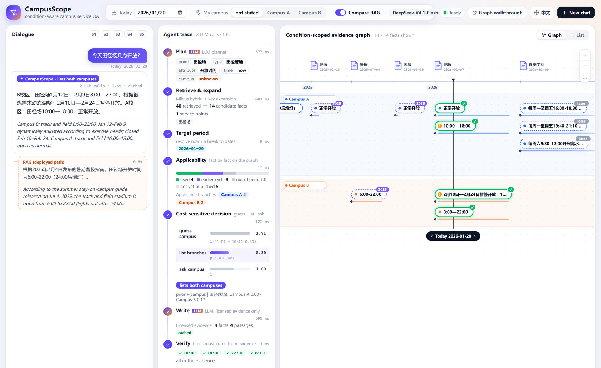

# CampusScope

**Condition-Scoped Evidence Graphs for Question Answering over Institutional Web Notices**

Demo paper submitted to The Web Conference 2027 (WWW '27 Companion, Demo Track).

<!-- TODO: add links when available: paper PDF · demo video · live demo -->

<p align="center">
  
</p>

<p align="center"><sub>
The interface on 20 January 2026 for "When is the track field open today?" (asked in Chinese, no campus stated).
Left: CampusScope lists both campuses, while the deployed RAG assistant answers with last summer's hours.
Middle: the agent trace, with the cost of guessing (1.71), listing (0.80) and asking (1.00).
Right: the timeline of the evidence graph; lanes are campuses, bars are validity periods, the black line is "today".
</sub></p>

<p align="center">
  <a href="#getting-started">Getting started</a> ·
  <a href="#reproducing-table-1">Reproducing Table 1</a> ·
  <a href="demo/README.md">Demo</a> ·
  <a href="#repository-layout">Repository layout</a> ·
  <a href="data/README.md">Data</a> ·
  <a href="#citation">Citation</a>
</p>

## Overview

Institutions publish their services on the Web as a stream of notices, each valid for one campus and one period
until a later notice amends it. Retrieval-augmented assistants answer from chunks that have lost these conditions,
so a grounded answer may still not apply to the asker.

CampusScope compiles an institution's public web notices with an LLM into a **condition-scoped evidence graph**:
facts and section passages keep the section path that fixes their campus and validity, and revision and recurrence
edges link notices over time. For each question, CampusScope determines which evidence applies to the asker and,
when an unstated condition changes the answer, chooses by expected cost whether to **answer, list the alternatives
or ask**. In the demo, visitors move the date or fix their campus and watch the applicable evidence change on a
timeline of the graph.

### Why chunks are not enough

Measured on the 1,009 public notices of the General Services Department of Renmin University of China and on its
prototype RAG assistant:

| | Challenge | Observation |
|---|---|---|
| **C1** | *Scope detachment.* A notice states a condition once and lists the facts it governs below it. | 42% of the 600-character chunks of two-campus notices name no campus; 31% mix both. |
| **C2** | *Silent conditions.* People seldom name their campus, and a chat box has no field for it. | 83% of the facts hold for one campus only. |
| **C3** | *Temporal validity.* Notices recur and later notices change single fields. | 12 notice families recur every break or term; 82% of dates omit the year. |

## Method

<!-- TODO: add the updated Figure 1 (system overview) as docs/figures/overview.png -->

**1. Evidence-graph compiler (offline, once per knowledge cutoff).**
An LLM returns each notice's outline (headings with the conditions they state) and extracts atomic facts
$f = (e, s, a, v, q)$: a service point $e$ of type $s$, an attribute $a$, a value $v$ and a verbatim quote $q$.
Facts whose quote does not occur in the notice are dropped. The position of $q$ places $f$ under a section path,
along which it inherits its scope $\sigma^{\ast}(f)$ and its validity $V(f) = [b(f), e(f)]$; a date without a year is
anchored in $[\tau(d) - 60\,\mathrm{d},\ \tau(d) + 400\,\mathrm{d}]$. Revision (*rev*) and recurrence (*rec*) edges
are computed from keys, scopes and dates, not by the LLM.

**2. Applicability reasoner (online).** Given the conditions $x$ the user stated, today's date $t$ and the target
period $T$, the applicable facts are

```math
A(x, t, T) = \{\, f : \sigma^*(f) \models x,\; \tau(f) \le t,\; V(f) \cap T \neq \emptyset,\; \nexists f' : \mathrm{rev}(f', f) \wedge \tau(f') \le t \,\}
```

**3. Cost-sensitive responder.** Partitioning $A$ by the campus the user left unstated gives branches $A_b$.
When they disagree, CampusScope takes the cheapest action, every cost counted in clarification turns:

```math
\min \Big\{ \underbrace{\lambda \big(1 - \max_b P(b \mid s)\big)}_{\text{guess } b^*},\;
\underbrace{\beta \big(\textstyle\sum_b |A_b| - |A_{b^*}|\big)}_{\text{list branches}},\;
\underbrace{1}_{\text{ask}} \Big\}
```

with $\lambda = 10$ and $\beta = 0.4$, fixed since the first full evaluation and never tuned. An LLM writer phrases
the answer from the applicable facts and scope-compatible passages, and a verifier rejects clock times that are
absent from the evidence.

From 342 service notices, the graph holds 4,031 facts, 1,947 passages, 1,964 revision edges and 627 recurrence edges.

## Results

**CondQA-RUC**: 247 questions over 57 real notices, answered by simulated users who reveal their hidden campus and
dates only when asked. All systems share the notices, retriever, knowledge cutoff, backbone
(DeepSeek-V4.1-Flash) and simulated user.

| System | Acc | T1 | T2 | T3 | T4 | T5 | T6 | SCE ↓ | TE ↓ | Sec. |
|---|---:|---:|---:|---:|---:|---:|---:|---:|---:|---:|
| RAG (deployed) | 65.6 | 85 | 58 | 96 | 10 | 65 | 66 | 4.5 | 15.9 | 3.9 |
| RAG + rules | 66.0 | 82 | 46 | 87 | 20 | 70 | 70 | 6.0 | 8.0 | 4.5 |
| Clarify-then-answer | 70.9 | 85 | 62 | 91 | 13 | 77 | 76 | 2.2 | 7.1 | 11.2 |
| ReAct agent | 72.5 | 88 | 46 | 83 | 47 | 75 | 74 | 3.0 | 8.0 | 9.3 |
| Passage RAG | 71.7 | 87 | 67 | 96 | 17 | 75 | 74 | 1.5 | 8.0 | 2.8 |
| &nbsp;&nbsp;+ date filter | 70.9 | 82 | 67 | 100 | 0 | 77 | 82 | 0.7 | 4.4 | 3.2 |
| Long context | 74.5 | 87 | 67 | 96 | 7 | 83 | 84 | 3.7 | 14.2 | 3.7 |
| **CampusScope** | **85.0** | 87 | 71 | 87 | 70 | 90 | 92 | 4.5 | 7.1 | 8.1 |

Accuracy overall and per question type, in %. T1 campus stated · T2 silent campus, values differ · T3 this cycle
differs from the last · T4 asked before its cycle's notice · T5 a later notice revised the field · T6 the place
implies the campus. SCE: silent-condition error (another campus's value). TE: temporal error (a stale or revised
value). Sec.: median seconds per item.

CampusScope answers 85.0% of the items correctly (95% CI 79.9–90.2), against 74.5% for the long-context reader
(*p* = 0.02 or lower against every baseline, bootstrap over notices).

## Demonstration scenarios

| | Scenario | What the visitor sees |
|---|---|---|
| **S1** | Silent campus (C2) | "When is the track field open today?" on 20 January 2026 without a campus: the branches disagree, and listing both (0.80) beats asking (1.00) and guessing (1.71). |
| **S2** | Scope stated (C1) | A Tongzhou student asks about the gym during the break and gets the Tongzhou section only. |
| **S3** | Revision (C3) | "When does the East bathhouse open in the morning?" on 9 March 2026: the September slot is struck through, revised in January; dragging "today" back to October makes it apply again. |
| **S4** | No notice yet (C3) | Winter-break hours asked in December 2025: no fact of the new cycle exists, so the *rec* edge leads to last winter's hours, given with their year. |

## Getting started

Requires Python ≥ 3.10 (and Docker for the demo).

```bash
git clone https://github.com/yanqiangmiffy/CampusScope.git
cd CampusScope
pip install -e ".[dev]"
cp .env.example .env        # model endpoints and Milvus; see the comments in the file
```

**Data and cache.** The data files, the run records and the LLM cache are not included in this repository.
With them, put the data files into `data/` (format: [data/README.md](data/README.md)), the cache into
`cache/llm_cache.sqlite` and the run records into `outputs/runs/`. The cache holds every LLM reply and embedding
of the paper's runs, so with it the demo and the scripts replay the paper without any model endpoint.

**Demo.** One command starts the front end, the back end and Milvus, and builds the index on first start:

```bash
cd demo
docker compose up -d --build          # http://localhost:8795
```

The interface is in English (`?lang=zh` for Chinese); the five scenarios work offline from the cache.
See [demo/README.md](demo/README.md) for the server setup with a shared Milvus, the URL parameters and the
fallbacks when a service is down.

**Tests.** `pytest` runs the unit tests of the mechanisms (scope inheritance, applicability with revision and
recurrence, the costs of Eq. 2, the metrics); they need neither data nor services.

## Reproducing Table 1

From the run records (`outputs/runs/`), without any model call:

```bash
python scripts/make_table.py          # -> outputs/table1.md, outputs/table1.json
```

Rerunning the systems (with the cache, the recorded calls are replayed):

```bash
docker compose -f demo/docker-compose.yml up -d milvus           # Milvus on localhost:19531
export MILVUS_URI=http://localhost:19531
python scripts/build_index.py --only chunks,full                 # all variants: no --only (ablations)
python scripts/run_benchmark.py --suite main                     # also: ablation, sweep
python scripts/run_scenarios.py                                  # S1-S5 of the demo
python scripts/make_table.py
```

For a few items whose named service point matches several graph keys equally well, `EvidenceGraph.lookup`
breaks the tie in hash order, so a rerun can differ from the recorded run on those items.

The full pipeline, in order:

| Script | Paper | Needs |
| --- | --- | --- |
| `scripts/check_env.py` | | checks Milvus, the embedder and the chat model |
| `scripts/prepare_corpus.py` | §2.1 | the notice PDFs (not distributed), Qwen3-32B |
| `scripts/compile_graph.py` | §2.2 | DeepSeek-V4.1-Flash (or the cache) |
| `scripts/build_index.py` | §3.1 | Milvus, bge-large-zh-v1.5 (or the cache) |
| `scripts/build_benchmark.py` | §4.1 | Bonsai-27B, Qwen3-32B |
| `scripts/run_benchmark.py` | §4.1 | Milvus, DeepSeek-V4.1-Flash (or the cache) |
| `scripts/run_scenarios.py` | §4.2 | Milvus, DeepSeek-V4.1-Flash (or the cache) |
| `scripts/make_table.py` | Table 1 | the run records only |

### Hyper-parameters

All fixed before the first full evaluation and never tuned.

| | Value | Where |
| --- | --- | --- |
| λ (cost of a wrong answer, in clarification turns) | 10 | `campusscope/policy.py` |
| β (cost of each extra listed fact) | 0.4 | `campusscope/policy.py` |
| Temperature, thinking | 0, off | `campusscope/llm.py` |
| Compiler window | 800 characters | `campusscope/compiler.py` |
| Year anchoring of dates | a date outside [τ(d) − 200 d, τ(d) + 400 d] takes the year that places it in [τ(d) − 60 d, τ(d) + 400 d] | `campusscope/text.py` |
| Baseline chunks | 600 characters, overlap 100, top 6 | `campusscope/chunking.py`, `campusscope/baselines.py` |
| Hybrid retrieval | bge-large-zh-v1.5 + BM25, RRF (k = 60) | `campusscope/search.py` |
| Clarifications per dialogue | at most 2 | `campusscope/evaluation/simulate.py` |

## Repository layout

```text
campusscope/                the system
├── compiler.py             evidence-graph compiler, LLM part: outline and span-grounded facts (§2.2)
├── graph.py                scope inheritance σ*(f), validity V(f), rev/rec edges (§2.2); applicability A(x,t,T) (Eq. 1)
├── policy.py               cost-sensitive responder: guess, list or ask (Eq. 2)
├── agent.py                the online agent: plan → ground → apply → decide → write → verify (§2.3, §3.2)
├── search.py, index.py     Milvus hybrid retrieval and the indexed units: chunks, facts, passages (§3.1)
├── baselines.py            the seven baselines of Table 1
├── evaluation/             simulated users, outcome-based judge, Table 1 metrics (§4.1)
└── llm.py, text.py, chunking.py, config.py
scripts/                    the pipeline (table above)
demo/                       the web demo: FastAPI + SSE back end, React front end, Docker Compose (§3.2, §3.3)
data/                       notices, compiled notices, CondQA-RUC (see data/README.md)
tests/                      unit tests (no data or services needed)
```

## Data and ethics

CampusScope is built on the notices that the General Services Department of Renmin University of China publishes
on its website (Comprehensive Services Portal) and on its official WeChat account. Two small aggregate files, a
place-name gazetteer and a per-type campus prior, were derived from the department's internal service log; they
contain no request text and no personal data (see [data/README.md](data/README.md)). No personal data reach a
model. The questions of CondQA-RUC are generated from the notices, and the users in the evaluation are simulated
by rules that answer a clarification truthfully, only about what was asked.

## License

The code is released under the [MIT License](LICENSE). The notices remain the property of their publisher.

## Citation

```bibtex
@inproceedings{yan2027campusscope,
  title     = {{CampusScope}: Condition-Scoped Evidence Graphs for Question Answering over Institutional Web Notices},
  author    = {Yan, Qiang and others},
  booktitle = {Companion Proceedings of the ACM Web Conference 2027},
  year      = {2027}
}
```

## Acknowledgments

We thank the General Services Department of Renmin University of China for publishing the notices this work builds
on and for their advice on the system and on the design of its services.
