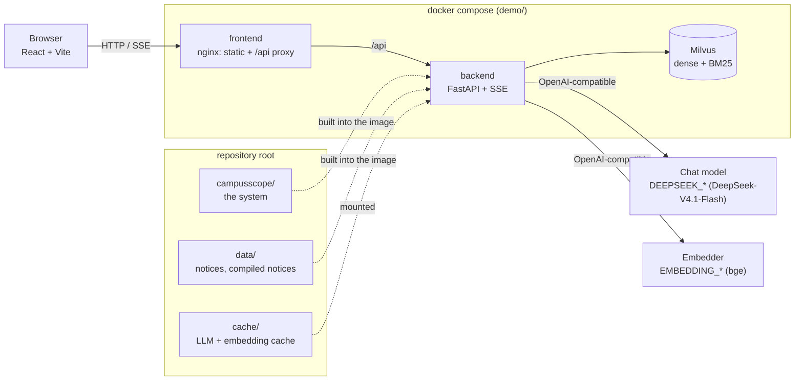

# Architecture



## The demo does not re-implement the system

`backend/app/system.py` puts the repository root on the path and imports `campusscope`, the package every
number of the paper comes from. `services/agent_service.py` is `CampusScope.respond` written as a generator
(same prompts, graph, policy and check) so each step can be sent as soon as it is done; a change of behaviour
belongs in `campusscope/agent.py` (and then Table 1 must be regenerated). The image contains `campusscope/`
and `data/` (compose `additional_contexts`); `cache/` is mounted, so replies the paper's runs cached replay
instantly and new ones are kept for `scripts/` too.

## Shared Milvus

`docker-compose.yml` runs the demo's own Milvus. On a server whose Milvus serves other applications,
`docker-compose.server.yml` starts only the backend and the frontend: the backend joins the Docker network of
the existing Milvus (`MILVUS_NETWORK`, `MILVUS_HOST`) and keeps its collections in a database of its own
(`MILVUS_DB`, created on first start), so it never reads or drops another application's collections.

## One question

```text
POST /api/chat
  QAService.answer (async generator)
    ├─ thread: StreamingCampusScope.stream
    │    plan (LLM) → retrieve + expand along graph keys → target period → applicability on the graph
    │    → graph event → cost-sensitive decision → write (LLM, streamed) → verify clock times
    ├─ thread: RAG baseline (chunk retrieval + one LLM call), in parallel
    └─ English glosses (lang=en), after each answer
  → events merged through an asyncio.Queue → SSE frames → terminal complete | error → [DONE]
```

The system's clients are synchronous, so they run in worker threads and hand events to the event loop with
`call_soon_threadsafe`; a keep-alive comment goes out every `KEEPALIVE_S` seconds of silence.

## Start-up

`main.py` answers `/api/health` at once and warms up in a thread:

1. load the evidence graph from `data/` (≈ 1 s);
2. wait for Milvus (compose already waits for its health check);
3. **index**: if a collection is missing or has the wrong row count, build it with `campusscope.index`
   (the same units as `scripts/build_index.py`: 696 notice chunks, 4031 fact nodes, 1947 section passages);
   vectors come from the embedding cache, then the endpoint, then zeros (BM25-only rows);
4. load the agents.

A question asked meanwhile waits and the UI says so (`status: warming`, indexing progress in the top bar).

## Degradation

| what fails | what happens |
| --- | --- |
| embedding endpoint (slow / 502) | 8 s timeout, then a 60 s breaker: retrieval is BM25 only, the trace says so; switches back by itself |
| a query embedding is cached | dense + BM25 as in the paper, no call |
| chat endpoint busy (503) | retried up to 4 times with back-off; the UI shows "retrying" |
| chat endpoint unreachable | the top bar says "model offline"; cached questions (all five scenarios) are still answered |
| RAG baseline fails | its card shows an error; the main answer is unaffected |
| any other error | terminal `error` event with a generic message; details in the backend log |

## Layout

```text
backend/app/
├── main.py            entry: warm-up, CORS, routers
├── config.py          settings (pydantic-settings; environment wins)
├── system.py          loads campusscope/ from the repository root, rewrites host endpoints for Docker
├── deps.py            lazy singletons (agents, QAService)
├── routers/           chat (SSE), health + meta: protocol only
├── services/          agent (steps), qa (merge + terminal event), graph (subgraph payload),
│                      llm_stream (token streaming + cache), retrieval (breaker), index (first-start ingest)
├── prompts/texts.py   scenarios, campus hint, gloss prompt
├── schemas/chat.py    request model
└── scripts/ingest.py  build / rebuild the collections
frontend/src/
├── api.ts             requests + SSE parsing
├── types.ts           event and data types
├── lib/events.ts      applies an event to a turn (pure)
├── lib/graph.ts       graph layout, status preview when "today" is dragged
├── hooks/             useChat (dialogue), useHealth (readiness, scenarios)
└── components/        TopBar, ChatPanel, TracePanel, EvidencePanel (GraphView, FactDrawer)
```
